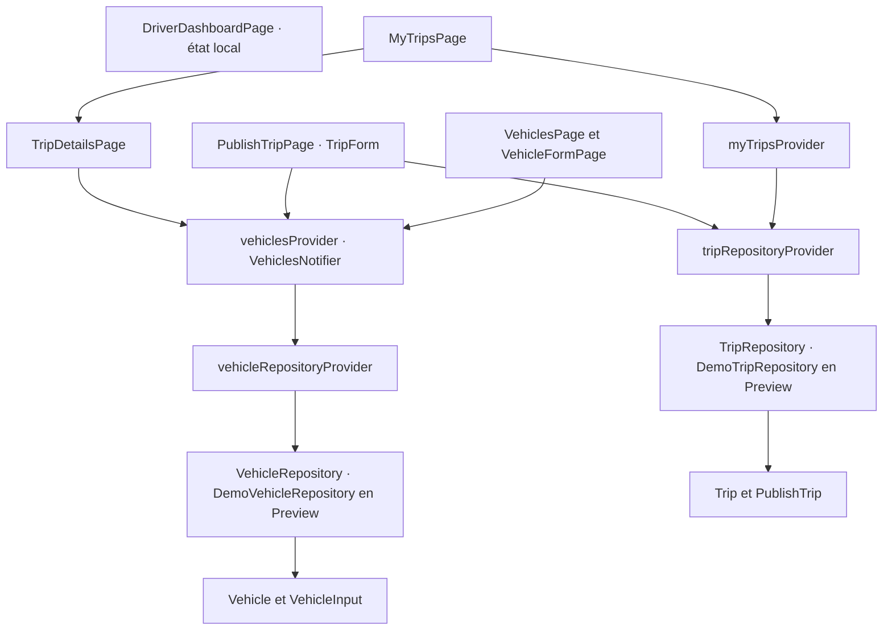
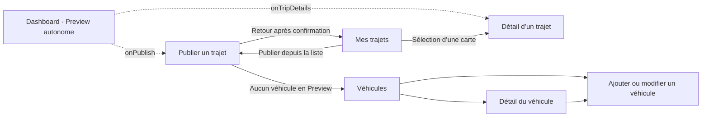

# Architecture Driver de SmartCar

## 1. Périmètre de Developer 2

Developer 2 prend en charge le Dashboard conducteur, le CRUD des véhicules et de leurs documents, la publication et la gestion des trajets. Le code Flutter utilise le style Olive clair. Les écrans sont testables avec des données locales et les intégrations API restent à réaliser.

## 2. État des fonctionnalités

| Fonctionnalité | Disponible aujourd’hui | Reste à faire |
| --- | --- | --- |
| Dashboard conducteur | Cartes et compteurs animés, avatars avec URL facultative et initiales en secours | Raccorder les données du conducteur et les actions de navigation à l’application principale |
| Véhicules | Liste, détail, ajout, modification et suppression confirmée, avec états vide, chargement et erreur | Persister les véhicules du conducteur via une API |
| Photo et carte grise | Caméra ou galerie, aperçu, remplacement et suppression. Le balayage du scanner est visuel | Définir l’envoi et le stockage des images, ainsi que les droits d’accès à la carte grise |
| Publier un trajet | Lieux saisis manuellement et inversables, date et TimePicker, véhicule, places, contribution et confirmation animée | Relier la publication à une API et appliquer les validations côté serveur |
| Mes trajets et détail | Onglets À venir, Passés et Annulés, détail du trajet sélectionné, rafraîchissement au retour de la publication | Charger les trajets du conducteur connecté via une API |
| Modifier et annuler un trajet | Actions visibles et désactivées dans le détail des trajets à venir. Le filtre Annulés existe | Implémenter les actions, compléter le contrat du repository et coordonner les règles avec les réservations |

## 3. Fichiers Flutter

Les chemins ci-dessous sont relatifs à `frontend/`. Les quatre fichiers `*_preview.dart` sont des points d’entrée temporaires présents localement. Ils ne sont pas suivis par Git et ne sont donc pas disponibles dans un clone de la branche.

```text
lib/features/
├── driver/
│   ├── driver_dashboard_preview.dart                  # Démarrage local du Dashboard
│   └── presentation/pages/driver_dashboard_page.dart # Dashboard, animations et avatars
├── vehicles/
│   ├── vehicles_preview.dart                         # Démarrage local du CRUD
│   ├── data/demo_vehicle_repository.dart             # Véhicules en mémoire
│   ├── domain/vehicle.dart                           # Vehicle, VehicleInput et VehicleRepository
│   └── presentation/
│       ├── vehicle_form_art.dart                     # Cadre de scan et confirmation animée
│       ├── vehicle_form_page.dart                    # Formulaire commun d’ajout et de modification
│       ├── vehicle_images.dart                       # Sélection et aperçu des images
│       ├── vehicle_provider.dart                     # Injection du repository et état de la liste
│       ├── vehicle_theme.dart                        # Style Olive clair réutilisé par les trajets
│       └── vehicles_page.dart                        # Liste, détail privé et suppression
└── trips/
    ├── publish_trip_preview.dart                     # Démarrage local de la publication seule
    ├── my_trips_preview.dart                         # Démarrage local de la liste et du parcours complet
    ├── data/
    │   ├── datasources/trips_remote_datasource.dart   # Fichier vide
    │   ├── models/trip_model.dart                     # Fichier vide
    │   └── repositories/
    │       ├── demo_trip_repository.dart              # Trajets en mémoire
    │       └── trip_repository_impl.dart              # Fichier vide
    ├── domain/
    │   ├── entities/
    │   │   ├── publish_trip.dart                      # Données du formulaire validé
    │   │   ├── trip.dart                              # Identifiant, statut et données du trajet
    │   │   └── trip_stop.dart                         # Fichier vide
    │   ├── repositories/trip_repository.dart          # Contrat de publication et de consultation
    │   └── usecases/
    │       ├── cancel_trip.dart                       # Fichier vide
    │       ├── get_my_trips.dart                      # Fichier vide
    │       └── update_trip.dart                       # Fichier vide
    └── presentation/
        ├── pages/
        │   ├── my_trips_page.dart                     # Liste, filtres et ouverture du détail
        │   ├── publish_trip_page.dart                 # Page qui accueille TripForm
        │   ├── trip_details_page.dart                 # Détail du trajet et actions à venir
        │   └── trip_form.dart                         # Saisie, validation et publication
        ├── providers/trip_provider.dart               # Injection du repository et lecture des trajets
        └── widgets/
            ├── trip_publish_confirmation.dart         # Confirmation de la publication
            └── trip_publish_controls.dart             # Cartes, boutons et contrôles Olive clair

test/driver/
├── driver_dashboard_test.dart                         # Compteurs animés et petit écran
├── vehicles_test.dart                                 # CRUD, immatriculation, images et états de liste
├── publish_trip_test.dart                             # Validation, inversion, horaire et accès aux véhicules
└── my_trips_test.dart                                 # Publication vers détail, onglets et libellés optionnels
```

## 4. Architecture Flutter

Le Dashboard reçoit ses données de présentation dans son constructeur et gère ses animations localement. Les autres écrans utilisent Riverpod. Les repositories sont fournis par l’application hôte via `ProviderScope`. `vehicleImagePickerProvider` permet de remplacer la sélection d’images pendant les tests.



## 5. Navigation

Les flèches pleines représentent les transitions disponibles dans les Previews. Les flèches en pointillé du Dashboard indiquent les callbacks à raccorder dans l’application principale. Le CRUD reste accessible depuis la publication quand aucun véhicule n’est disponible en mode Preview.



## 6. Parcours de publication

1. Ouvrir `PublishTripPage`, qui affiche `TripForm`.
2. Saisir le départ et la destination. `_swap()` échange leur texte et déclenche l’animation du bouton.
3. Choisir la date, puis l’heure exacte avec le TimePicker. Les boutons plus et moins gardent un pas de 15 minutes.
4. Sélectionner un véhicule proposé par `vehiclesProvider`, puis choisir le nombre de places dans la limite de sa capacité et renseigner la contribution.
5. `_publish()` valide les lieux, le véhicule et la date future. Il crée un `PublishTrip` et appelle `TripRepository.publish()`. Une contribution à zéro est stockée sous forme de valeur absente.
6. Le repository de démonstration ajoute le trajet à la session et le formulaire affiche la confirmation. Depuis `MyTripsPage`, le retour invalide `myTripsProvider` pour relire la liste.
7. Toucher la carte du trajet pour ouvrir `TripDetailsPage`. Le détail reçoit l’objet `Trip` sélectionné et retrouve le véhicule par son identifiant.

## 7. Démonstration et raccordement au backend

- Le Dashboard affiche des valeurs de démonstration. Les URLs d’avatars du Preview servent à tester le chargement et le secours par initiales.
- `DemoVehicleRepository` est initialisé avec une Dacia Logan de démonstration. Les modifications et les images restent en mémoire.
- `DemoTripRepository` commence sans trajet par défaut. Dans `my_trips_preview.dart`, la liste et la publication partagent la même instance. Chaque redémarrage réinitialise la session.
- Express monte le routeur sous `/api/v1`. Le routeur actuel déclare `/health` et monte `/auth`. Le fichier `backend/src/routes/trips/trips.routes.js` est vide et aucun routeur véhicules n’est monté. Les API Driver de cette documentation restent donc à implémenter.
- Pour le raccordement, conserver les interfaces des repositories comme point d’entrée Flutter. Définir avec l’équipe les requêtes et réponses, la propriété des véhicules et trajets, l’envoi des images et les erreurs à afficher. Fournir les implémentations distantes via les providers existants. Vérifier aussi les dates, capacités et droits côté serveur.

## 8. Modèles et relations

| Type | Données et relations |
| --- | --- |
| `VehicleInput` | `make`, `model`, `color`, `year` facultative, `registrationNumber`, `passengerCapacity`, `photo` et `registrationPhoto` facultatives en `Uint8List`. |
| `Vehicle` | `id` et `details` de type `VehicleInput`. `name` combine la marque et le modèle. |
| `PublishTrip` | `origin`, `destination`, `departureAt`, `vehicleId`, `seats` et `contributionDh` facultative. `vehicleId` référence `Vehicle.id`. |
| `Trip` | `id`, `details` de type `PublishTrip` et `status` de type `TripStatus`. Les statuts sont `published` et `cancelled`. `isUpcoming()` compare la date de départ au moment courant pour un trajet publié. |

Les lieux de `PublishTrip` sont du texte. Le détail accepte aussi des libellés de coordonnées optionnels fournis par l’hôte. Le parcours Driver ne collecte aucune position.

## 9. Points d’intégration avec l’équipe

| Responsable | Point à coordonner |
| --- | --- |
| Developer 1 · Auth | Réutiliser la session Firebase et le middleware Express `authenticate`, qui vérifie le jeton Bearer. Déterminer comment associer le conducteur connecté à ses véhicules et trajets avant de monter les routes Driver. |
| Developer 3 · Réservations | Utiliser un identifiant de trajet commun et convenir des règles de capacité, de modification et d’annulation lorsqu’un trajet a des réservations. |
| Developer 4 · Maps | Lui laisser Google Maps, GPS, Geolocator et la sélection de lieux. Convenir du format des lieux et des éventuelles coordonnées avant de le raccorder au formulaire Driver. |

## 10. Lancer et tester

Depuis la racine du dépôt, avec le SDK Flutter configuré. Les commandes `flutter run` supposent que le point d’entrée Preview correspondant est présent dans la copie locale. Utiliser `flutter devices` pour obtenir l’identifiant du téléphone et ajouter `-d IDENTIFIANT` à la commande choisie.

```powershell
cd frontend
flutter pub get
flutter devices
flutter run -t lib/features/driver/driver_dashboard_preview.dart
flutter run -t lib/features/vehicles/vehicles_preview.dart
flutter run -t lib/features/trips/publish_trip_preview.dart
flutter run -t lib/features/trips/my_trips_preview.dart
```

Pour tester le parcours complet, lancer uniquement `my_trips_preview.dart`, publier depuis la liste, revenir après la confirmation et ouvrir la carte dans l’onglet À venir. Pour tester la caméra et la galerie, utiliser le Preview Véhicules sur Android.

```powershell
flutter analyze lib/features/driver lib/features/vehicles lib/features/trips test/driver
flutter test test/driver
```

## 11. Précautions avant l’intégration

- Garder une instance commune de chaque repository pour la publication, la liste et le détail. Ajouter les nouvelles implémentations derrière les providers existants.
- Coordonner les modifications de `main.dart`, de la HomePage, de la navigation partagée et du routeur Express avec leurs responsables.
- Conserver les corrections Android et Firebase locales pendant les essais. Vérifier les fichiers ajoutés à Git et garder les Previews temporaires, les secrets et les fichiers générés hors des commits Driver.
- Rejouer les tests Driver après un changement de contrat et vérifier le parcours de publication sur petit écran.
