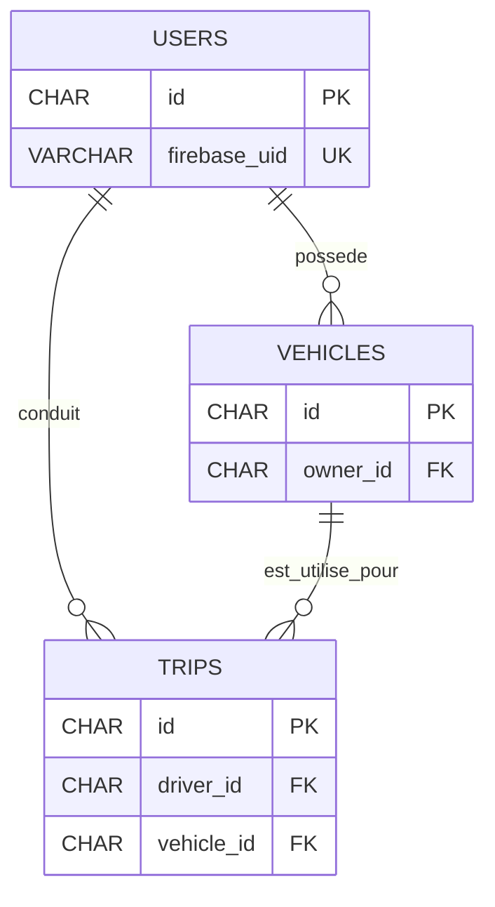

# Base de données Driver — DEV 2

Le Backend Express utilise Sequelize 6 et le pilote `mysql2` pour accéder à MySQL ou MariaDB. Le développement local a été vérifié sur MariaDB via XAMPP. Firebase Authentication vérifie l’identité du compte. Les données Driver sont stockées dans `vehicles` et `trips`. La table `users` relève du module Auth.

Pour configurer la connexion et appliquer les migrations locales dans l’ordre, voir le [guide XAMPP Driver](../sql/DRIVER_MYSQL.md).

## Installation du schéma Driver

Deux méthodes alternatives créent le même schéma sur une base où `users` a déjà été initialisée par DEV 1 : importer [driver_schema.sql](../sql/driver_schema.sql) dans phpMyAdmin ou exécuter les migrations Sequelize Driver dans l’ordre `vehicles` puis `trips`. Choisir une seule méthode par base. Le script SQL reprend les deux définitions de table des migrations et laisse `users` intacte. Le Backend utilise les mêmes modèles Sequelize avec les deux méthodes.

## Table `vehicles`

Migration [création de vehicles](20261124000100-create-vehicles.js) et [modèle Sequelize Vehicle](../src/models/vehicle.js).

| Colonne | Type SQL | NULL | Valeur par défaut et contraintes |
| --- | --- | --- | --- |
| `id` | `CHAR(36)` | Non | Clé primaire. UUID v4 généré par Sequelize, sans défaut SQL. |
| `owner_id` | `CHAR(36)` | Non | Clé étrangère vers `users.id`. Sans défaut SQL. |
| `make` | `VARCHAR(255)` | Non | Marque. Sans défaut SQL. |
| `model` | `VARCHAR(255)` | Non | Modèle. Sans défaut SQL. |
| `color` | `VARCHAR(255)` | Non | Couleur. Sans défaut SQL. |
| `year` | `SMALLINT UNSIGNED` | Oui | `NULL` si absent. `CHECK (year IS NULL OR year >= 1900)`. |
| `registration_number` | `VARCHAR(16)` | Non | Immatriculation marocaine normalisée par Joi. Sans défaut SQL. |
| `passenger_capacity` | `INT UNSIGNED` | Non | `CHECK (passenger_capacity >= 1)`. Sans défaut SQL. |
| `photo_key` | `VARCHAR(255)` | Oui | `NULL` si absent. Clé interne de la photo. |
| `registration_photo_key` | `VARCHAR(255)` | Oui | `NULL` si absent. Clé interne de la carte grise. |
| `verification_status` | `ENUM('PENDING', 'APPROVED', 'REJECTED')` | Non | `PENDING`. |
| `created_at` | `DATETIME(3)` | Non | Gérée par Sequelize, sans défaut SQL. |
| `updated_at` | `DATETIME(3)` | Non | Gérée par Sequelize, sans défaut SQL. |

Index déclarés :

- `PRIMARY KEY (id)`.
- `vehicles_owner_idx (owner_id)` pour les recherches par propriétaire.
- `vehicles_id_owner_unique (id, owner_id)`, clé unique ciblée par la contrainte composite des trajets.

`vehicles_owner_fk` relie `owner_id` à `users.id` avec `ON DELETE RESTRICT` et `ON UPDATE RESTRICT`.

## Table `trips`

Migration [création de trips](20261124000200-create-trips.js) et [modèle Sequelize Trip](../src/models/trip.js).

| Colonne | Type SQL | NULL | Valeur par défaut et contraintes |
| --- | --- | --- | --- |
| `id` | `CHAR(36)` | Non | Clé primaire. UUID v4 généré par Sequelize, sans défaut SQL. |
| `driver_id` | `CHAR(36)` | Non | Clé étrangère vers `users.id` et partie de la clé étrangère véhicule. Sans défaut SQL. |
| `vehicle_id` | `CHAR(36)` | Non | Partie de la clé étrangère composite vers `vehicles`. Sans défaut SQL. |
| `origin` | `TEXT` | Non | Texte du départ. Sans défaut SQL. |
| `destination` | `TEXT` | Non | Texte de l’arrivée. Sans défaut SQL. |
| `departure_at` | `DATETIME(3)` | Non | Départ enregistré en UTC et renvoyé en ISO 8601. Sans défaut SQL. |
| `seats` | `INT UNSIGNED` | Non | `CHECK (seats >= 1)`. Sans défaut SQL. |
| `contribution_dh` | `TINYINT UNSIGNED` | Oui | `NULL` si absent. `CHECK (contribution_dh BETWEEN 0 AND 40)`. |
| `status` | `ENUM('published', 'in_progress', 'completed', 'cancelled')` | Non | `published`. |
| `created_at` | `DATETIME(3)` | Non | Gérée par Sequelize, sans défaut SQL. |
| `updated_at` | `DATETIME(3)` | Non | Gérée par Sequelize, sans défaut SQL. |

Index et clés déclarés :

- `PRIMARY KEY (id)`.
- `trips_driver_status_departure_idx (driver_id, status, departure_at)`.
- `trips_vehicle_driver_idx (vehicle_id, driver_id)`.
- `trips_driver_fk` relie `driver_id` à `users.id`.
- `trips_vehicle_owner_fk` relie `(vehicle_id, driver_id)` à `vehicles(id, owner_id)`. Cette liaison garantit que le conducteur du trajet possède le véhicule.

Les deux clés étrangères de `trips` utilisent `ON DELETE RESTRICT` et `ON UPDATE RESTRICT`. Les deux tables Driver utilisent InnoDB, `utf8mb4` et la collation par défaut `utf8mb4_unicode_ci`. Leurs identifiants UUID et clés étrangères en `CHAR(36)` utilisent `utf8mb4_bin`, comme `users.id` dans le schéma commun.

## Relations

Dans Sequelize, `Vehicle` expose la relation `owner` vers `User`. `Trip` expose `driver` et `vehicle`, et `Vehicle` expose `trips`. La migration impose la clé composite côté SQL.

## Identité, statuts et règles métier

- Le middleware Firebase vérifie le jeton Bearer et place son UID dans `req.user.uid`. Le [repository d’identité Driver](../src/repositories/driver-owner.js) recherche `users.firebase_uid`, vérifie l’égalité exacte de l’UID et récupère `users.id`. Les repositories filtrent ensuite `vehicles.owner_id` ou `trips.driver_id`. Le client ne choisit pas le propriétaire ni le conducteur.
- Le statut véhicule est initialisé à `PENDING`. Le schéma prévoit aussi `APPROVED` et `REJECTED`. L’API Driver ne permet pas de modifier ce champ et le service Trajets ne conditionne pas la publication à l’approbation.
- Pour publier ou modifier, les lieux doivent être distincts, le départ futur et le véhicule appartenir au conducteur. Les places sont contrôlées par rapport à sa capacité. Joi exige une contribution entière de 0 à 40 DH ou une valeur absente. Le service convertit 0 en `NULL`.
- Un trajet `published` peut être modifié ou annulé avant l’heure de départ. Il peut être démarré à partir de cette heure, ce qui le fait passer à `in_progress`. Seul un trajet `in_progress` peut passer à `completed`. L’annulation conserve la ligne et utilise `cancelled`. Les changements d’état utilisent des transactions et des verrous sur la ligne du trajet.
- La suppression d’un véhicule référencé par **un trajet de n’importe quel statut** est refusée par la clé étrangère. Le repository traduit ce refus en HTTP `409`. Un véhicule sans référence peut être supprimé par son propriétaire, avec nettoyage des fichiers associés.

## Photos et cartes grises

Le [repository Véhicules](../src/repositories/vehicles/vehicles.repository.js) écrit les images sous `backend/uploads/driver-vehicles/` avec des noms aléatoires. La base conserve les clés `photo_key` et `registration_photo_key`. Il n’existe aucune table `vehicle_documents`. Les routes acceptent JPEG, PNG et WebP jusqu’à 2 Mio par image.

Les réponses restent réservées au propriétaire et utilisent `Cache-Control: no-store`. Le détail peut contenir `registrationPhoto` en Base64. La liste renvoie seulement `hasRegistrationPhoto` pour la carte grise. Les clés de stockage ne font pas partie de la réponse API.

## Passage de relais à DEV 3 et DEV 4

**DEV 3 — Réservations.** Utiliser `trips.id` comme identifiant de référence du trajet et `users.id` comme identifiant interne de compte. Une éventuelle clé étrangère texte vers ces colonnes devra reprendre `CHAR(36)` et `utf8mb4_bin`. La colonne `trips.seats` contient les places proposées par le conducteur. Le service Driver ne calcule pas le nombre de places restantes à partir des réservations.

**DEV 4 — Chat et Notifications.** Pour obtenir le conducteur à partir d’un trajet, joindre `trips.driver_id` à `users.id`. Pour obtenir son UID Firebase, lire `users.firebase_uid`. Utiliser la relation de réservation publiée par DEV 3 pour identifier et autoriser le passager avant de créer une conversation ou d’envoyer une notification.

Au moment de la rédaction, le Backend ne définit ni migration ni modèle Sequelize pour les réservations. Le nom de leur table, leur clé primaire, leurs clés de liaison et leur statut d’acceptation restent à confirmer avec DEV 3. Le statut `accepted` du Preview Flutter appartient aux données de démonstration.
